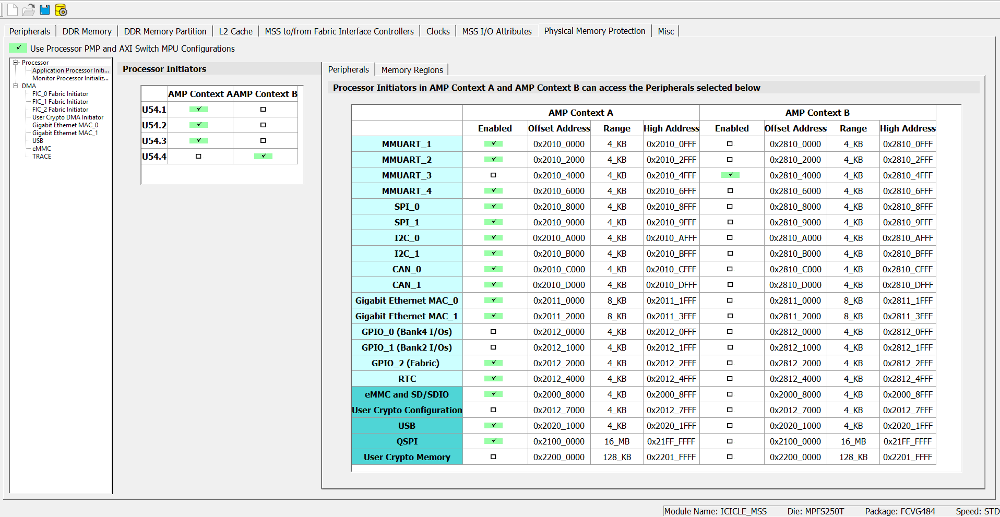
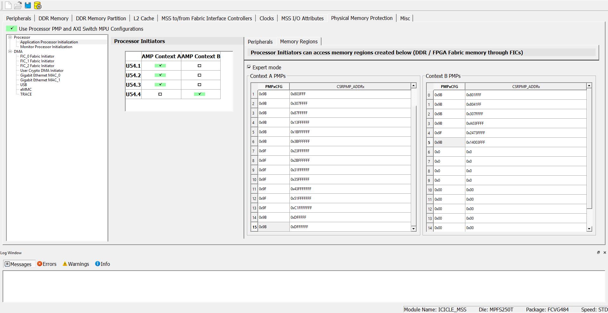
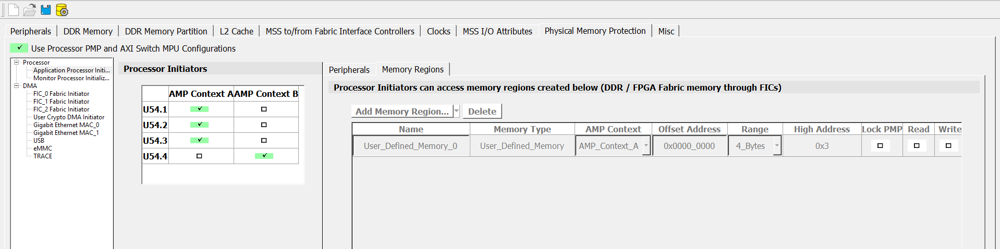
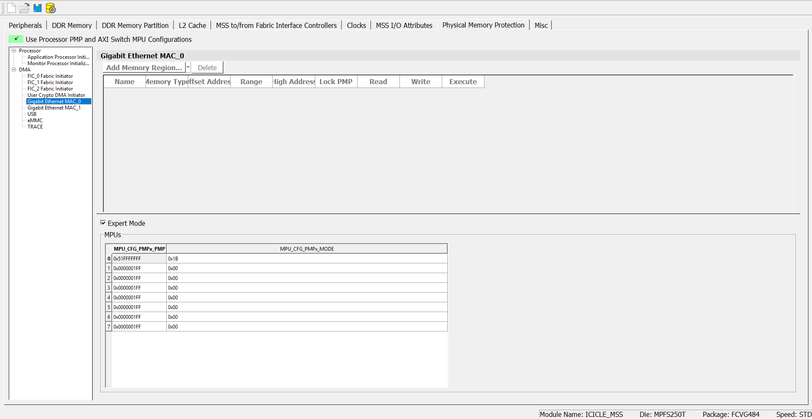
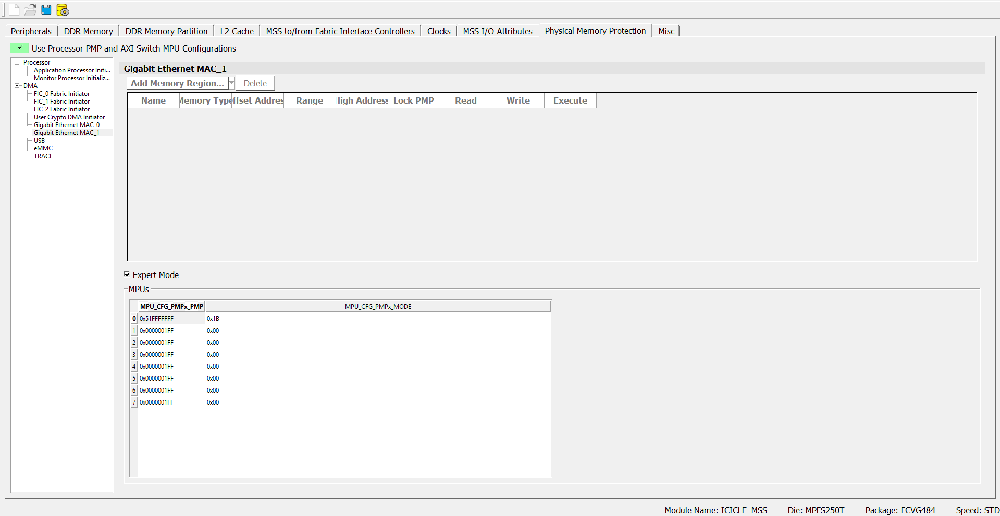
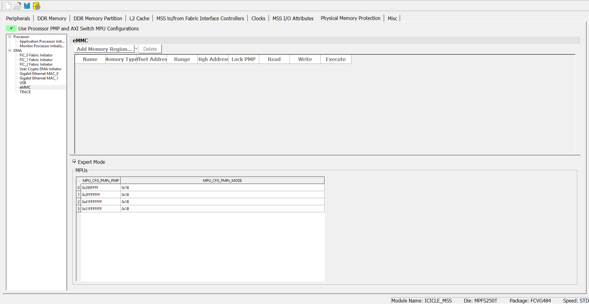

# PolarFire SoC AMP Demo: Linux and Bare-Metal RTOS with PMP Isolation

## Objective

This document describes the Physical Memory Protection (PMP) configuration used
in the Linux + FreeRTOS/Bare Metal demo on the PolarFire SoC Icicle Kit, where
Linux and a bare-metal/RTOS run concurrently on separate U54 cores with
hardware-enforced memory isolation.

## Description

The demo runs two independent software contexts:

| Hart      | Context | OS/Firmware     |
|-----------|---------|-----------------|
| 0 (E51)   |    -    | HSS             |
| 1–3 (U54) | **A**   | Linux           |
| 4 (U54)   | **B**   | Bare-metal RTOS |

Each U54 hart has its own set of 16 PMP entries programmed at boot by the HSS.
These entries define which memory regions and peripherals each context can
access.

In this demo, each hart can only access regions explicitly
listed in its PMP table and any other access causes a hardware trap.

In this example, PMP enforces this partition by allowing Context B to access
only its assigned memory, peripherals, and shared RPMsg resources. Context A
is given broader PMP access because Linux remoteproc is responsible for loading
and managing the Context B firmware lifecycle, and RPMsg provides the communication
channel between the two contexts.

The FreeRTOS application running on Context B is provided by the
[mpfs-rpmsg-freertos](https://github.com/polarfire-soc/polarfire-soc-amp-examples/tree/main/mpfs-rpmsg-freertos)
example in the `polarfire-soc-amp-examples` repository.

Peripheral isolation is enforced by the `APBBUS_CR` register assignment:

- Context A peripherals are in the `0x20000000` range.
- Context B peripherals are in the `0x28000000` range.
- Neither context's PMP table includes the other's peripheral range.

## Requirements

- PolarFire SoC Icicle Kit
- Libero SoC v2025.2 or later
- Hart Software Services (HSS)
- PolarFire SoC [meta-mchp](https://github.com/linux4microchip/meta-mchp) Yocto BSP layer

## PMP Configuration

### Hart 0 (E51 monitor)

No PMP regions configured. Hart 0 runs HSS in M-mode with no PMP restrictions.

### Harts 1-3 (U54, Context A - Linux)

Identical across all three harts. Any address outside the listed regions causes a trap.

| PMP   | CFG    | L | R | W | X | `pmpaddr` (CSR value)| Base           | Size   | End (excl.)    | Purpose                                       |
|-------|--------|---|---|---|---|----------------------|----------------|--------|----------------|-----------------------------------------------|
| 0     | `0x00` | — | — | — | — | `0x00000000`         | —              | —      | —              | OpenSBI detection sentinel (A=OFF)            |
| 1     | `0x9B` | 1 | 1 | 1 | 0 | `0x00803FFF`         | `0x02000000`   | 128 KB | `0x02020000`   | CLINT/timer + CCache regs                     |
| 2     | `0x9B` | 1 | 1 | 1 | 0 | `0x0307FFFF`         | `0x0C000000`   | 4 MB   | `0x0C400000`   | PLIC                                          |
| 3     | `0x9B` | 1 | 1 | 1 | 0 | `0x087FFFFF`         | `0x20000000`   | 64 MB  | `0x24000000`   | APB peripherals Context A                     |
| 4     | `0x9B` | 1 | 1 | 1 | 0 | `0x13FFFFFF`         | `0x40000000`   | 512 MB | `0x60000000`   | FIC3-FAB: CorePWM, CoreUART, CoreI2C          |
| 5     | `0x9B` | 1 | 1 | 1 | 0 | `0x1BFFFFFF`         | `0x60000000`   | 512 MB | `0x80000000`   | FIC0 low: fpgaDMA, fpgaLSRAM                  |
| 6     | `0x9B` | 1 | 1 | 1 | 0 | `0x3BFFFFFF`         | `0xE0000000`   | 512 MB | `0x100000000`  | FIC1 low                                      |
| 7     | `0x9F` | 1 | 1 | 1 | 1 | `0x23FFFFFF`         | `0x80000000`   | 512 MB | `0xA0000000`   | kernel, fabricbuf0ddrc, ddr_cached_low        |
| 8     | `0x9F` | 1 | 1 | 1 | 1 | `0x2BFFFFFF`         | `0xA0000000`   | 512 MB | `0xC0000000`   | DDR gap (U-Boot DRAM probe range)             |
| 9     | `0x9F` | 1 | 1 | 1 | 1 | `0x0031FFFFFF`       | `0xC0000000`   | 256 MB | `0xD0000000`   | ddr_non_cached_low, fabricbuf1ddrnc           |
| 10    | `0x9F` | 1 | 1 | 1 | 1 | `0x0035FFFFFF`       | `0xD0000000`   | 256 MB | `0xE0000000`   | fabricbuf2ddrncwcb                            |
| 11    | `0x9F` | 1 | 1 | 1 | 1 | `0x043FFFFFFF`       | `0x1000000000` | 8 GB   | `0x1200000000` | ddr_cached_high                               |
| 12    | `0x9F` | 1 | 1 | 1 | 1 | `0x051FFFFFFF`       | `0x1400000000` | 4 GB   | `0x1500000000` | ddr_non_cached_high, hss buffer               |
| 13    | `0x9F` | 1 | 1 | 1 | 1 | `0x0C1FFFFFFF`       | `0x3000000000` | 4 GB   | `0x3100000000` | PCIe config/IO/MEM space                      |
| 14    | `0x9B` | 1 | 1 | 1 | 0 | `0x00DFFFFF`         | `0x03000000`   | 16 MB  | `0x04000000`   | PDMA                                          |
| 15    | `0x9B` | 1 | 1 | 1 | 0 | `0x0DFFFFFF`         | `0x30000000`   | 256 MB | `0x40000000`   | SCB, mailbox, clkcfg, CCC controllers         |

### Hart 4 (U54, Context B - RTOS)

Any address outside the listed regions causes a hardware access fault.

| PMP  | CFG    | L | R | W | X | `pmpaddr` (CSR value)| Base           | Size   | End (excl.)    | Purpose                                             |
|------|--------|---|---|---|---|----------------------|----------------|--------|----------------|-----------------------------------------------------|
| 0    | `0x9B` | 1 | 1 | 1 | 0 | `0x00801FFF`         | `0x02000000`   | 64 KB  | `0x02010000`   | CLINT/timer                                         |
| 1    | `0x9B` | 1 | 1 | 1 | 0 | `0x008041FF`         | `0x02010000`   | 4 KB   | `0x02011000`   | CCache regs                                         |
| 2    | `0x9B` | 1 | 1 | 1 | 0 | `0x0307FFFF`         | `0x0C000000`   | 4 MB   | `0x0C400000`   | PLIC                                                |
| 3    | `0x9B` | 1 | 1 | 1 | 0 | `0x0A03FFFF`         | `0x28000000`   | 2 MB   | `0x28200000`   | APB peripherals Context B (full range)              |
| 4    | `0x9F` | 1 | 1 | 1 | 1 | `0x2473FFFF`         | `0x91C00000`   | 2 MB   | `0x91E00000`   | FreeRTOS firmware, vrings, IPC buffers              |
| 5    | `0x9B` | 1 | 1 | 1 | 0 | `0x14003FFF`         | `0x50000000`   | 128 KB | `0x50020000`   | MiV IHC block — inter-hart communication            |
| 6–15 | `0x00` | — | — | — | — | `0x00000000`         | —              | —      | —              | Disabled — default deny                             |

**Context B DDR layout (within PMP4 window `0x91C00000–0x91DFFFFF`):**

| Region              | Base         | Size   | Purpose                     |
|---------------------|--------------|--------|-----------------------------|
| `contextb_reserved` | `0x91C00000` | 1 MB   | FreeRTOS firmware load area |
| `vdev0vring0`       | `0x91D00000` | 32 KB  | virtio ring 0 (tx)          |
| `vdev0vring1`       | `0x91D08000` | 32 KB  | virtio ring 1 (rx)          |
| `vdev0buffer`       | `0x91D10000` | 256 KB | virtio buffer pool          |
| `rsctable`          | `0x91D50000` | 4 KB   | Resource table              |

> For CFG byte and naturally aligned power-of-two (NAPOT) address encoding see
> [Register Reference](#register-reference).

### AMP peripheral assignment (`APBBUS_CR`)

The MSS configurator sets the `APBBUS_CR` register which controls which AXI
bus each APB peripheral appears on. A bit value of `0` maps the peripheral into
the `0x20000000` range and `1` maps it into the `0x28000000` range.

In this demo all Context A peripherals are mapped into the `0x20000000` range
and all Context B peripherals are mapped into the `0x28000000` range. This
allows each context's PMP table to grant access to its own peripheral bus with
a single NAPOT window (64 MB for Context A, 2 MB for Context B), with no
overlap between the two contexts.

## MPU Configuration

The MSS fabric MPU (Memory Protection Unit) controls DMA master access to DDR
and peripherals independently of the hart PMP entries.

### Active MPU entries

Each MPU unit protects a single DMA-capable bus master (GEM0, GEM1, MMC, USB,
FIC0, FIC1, FIC2, SCB, Crypto, Trace). Each entry is a 64-bit register using
the same NAPOT address and MODE byte encoding as the PMP CFG byte. See
[Register Reference](#register-reference) for
details.

All MPU masters not listed below (FIC0, FIC1, FIC2, USB, SCB, Crypto, Trace)
are left with default permissive access — `MODE=0x1F`, `PMP=0xFFFFFFFFF` —
meaning no DMA restriction is applied to those masters in this demo.

#### GEM0 and GEM1

Both Ethernet controllers have identical single-entry configurations allowing
DMA over the full `ddr_non_cached_high` window.

| Entry | MODE   | PMP value      | Base           | Size | End (excl.)    | Purpose                      |
|-------|--------|----------------|----------------|------|----------------|------------------------------|
| 0     | `0x1B` | `0x51FFFFFFF`  | `0x1400000000` | 4 GB | `0x1500000000` | `ddr_non_cached_high` (unlocked RW) |
| 1–7   | `0x00` | `0x0000001FF`  | —              | —    | —              | Disabled                     |

#### MMC (eMMC/SD controller)

The MMC controller has four active entries covering the peripheral address space
and the three DDR windows used by the Linux MMC driver for DMA.

| Entry | MODE   | PMP value     | Base           | Size   | End (excl.)    | Purpose                            |
|-------|--------|---------------|----------------|--------|----------------|------------------------------------|
| 0     | `0x1B` | `0x280FFFF`   | `0x0A000000`   | 512 KB | `0x0A080000`   | Fabric/FIC address window          |
| 1     | `0x1B` | `0x2FFFFFFF`  | `0x80000000`   | 2 GB   | `0x100000000`  | `ddr_cached_low` (32-bit DDR)      |
| 2     | `0x1B` | `0x41FFFFFFF` | `0x100000000`  | 4 GB   | `0x200000000`  | `ddr_non_cached`                   |
| 3     | `0x1B` | `0x51FFFFFFF` | `0x1400000000` | 4 GB   | `0x1500000000` | `ddr_non_cached_high`              |

## MSS Configurator

The PMP register values in the tables above are generated by the PolarFire SoC
MSS Configurator. Expert Mode gives direct access to the raw `CSRPMP_ADDRx`
and `PMPxCFG` fields, allowing PMP usage to be optimized. For example by
combining adjacent regions into a single NAPOT entry to stay within the
16-entry hardware limit.

The recommended workflow is to start with the GUI to assign regions, then
switch to Expert Mode to verify and adjust the final values before saving
the XML.

The screenshots below show the MSS Configurator as configured for this demo.

**Peripherals tab - Context A and B peripheral assignments:**

1. Enable the **Use Processor PMP and AXI Switch MPU Configurations** checkbox at
   the top of the Physical Memory Protection tab.
2. In the **Processor Initiators** panel, assign harts to contexts:
  - Set U54.1, U54.2, and U54.3 to **AMP Context A**.
  - Set U54.4 to **AMP Context B**.
3. In the **Peripherals** tab, enable each peripheral for the correct context as
   shown in the screenshot above. Context A should have all Linux peripherals
   enabled (MMUART1, MMUART2, MMUART4, SPI0, SPI1, I2C0, I2C1, CAN0, CAN1,
   GEM0, GEM1, GPIO2, RTC, eMMC and SD/SDIO, USB, QSPI) and Context B should
   have MMUART3 enabled.



**Expert mode - Context A and B PMP tables overview:**

Enable the **Expert mode** checkbox in the **Memory Regions** tab. This exposes
the raw `PMPxCFG` and `CSRPMP_ADDRx` fields for Context A and Context B
directly. Enter the `CFG` and `pmpaddr` values for each entry exactly as listed
in the [PMP Configuration](#pmp-configuration) section.



**Memory Regions tab with Expert mode PMP tables:**

The MSS Configurator requires at least one memory region to be defined in the
GUI before it will accept the configuration. Since all PMP entries have already
been configured directly in Expert mode in the step above, add a single dummy
entry in the **Memory Regions** tab with an offset address of `0x0`. This
satisfies the GUI requirement without affecting the actual PMP configuration.



**GEM0 MPU expert mode:**

Select **Gigabit Ethernet MAC_0** in the DMA tree, enable **Expert Mode**, and
enter the `MPU_CFG_PMPx_PMP` and `MPU_CFG_PMPx_MODE` values as listed in the
[MPU Configuration](#mpu-configuration) section.



**GEM1 MPU expert mode:**

Repeat the same steps for **Gigabit Ethernet MAC_1**, using the identical values
as GEM0 per the [MPU Configuration](#mpu-configuration) section.



**eMMC MPU expert mode:**

Select **eMMC** in the DMA tree, enable **Expert Mode**, and enter the
`MPU_CFG_PMPx_PMP` and `MPU_CFG_PMPx_MODE` values as listed in the
[MPU Configuration](#mpu-configuration) section.



### HSS Kconfig (DTB relocation)

The HSS built-in DTB resides in the HSS firmware region and must be copied to
a DDR address accessible from S-mode before being passed to OpenSBI/U-Boot on
Context A (harts 1–3).

The following options must be present in `boards/mpfs-icicle-kit/def_config`:

```text
CONFIG_PROVIDE_DTB=y
CONFIG_PROVIDE_DTB_DDR_ADDR=0x80100000
```

`0x80100000` falls within the `ddr_cached_low` range covered by PMP7
(`0x80000000–0x9FFFFFFF`) on harts 1–3 and is therefore accessible from
S-mode.

### Applying the XML to the HSS

Once the configuration is saved from the MSS Configurator, the generated XML
file must be placed in the HSS board directory and the HSS must be recompiled
for the changes to take effect.

1. Copy the generated XML into the HSS board directory:

   ```sh
   cp <path-to-generated-xml> boards/mpfs-icicle-kit/soc_fpga_design/xml/ICICLE_MSS_mss_cfg.xml
   ```

2. Rebuild the HSS:

   ```sh
   make BOARD=mpfs-icicle-kit
   ```

3. Flash the resulting HSS binary to the board. The new PMP and MPU
   configuration takes effect on the next boot.

   ```sh
   make BOARD=mpfs-icicle-kit program
   ```

### Applying the XML in a Yocto build

The [`ICICLE_MSS_cfg.xml`](https://github.com/polarfire-soc/polarfire-soc-amp-examples/blob/main/mpfs-rpmsg-freertos/src/boards/icicle-kit-es/fpga_design/design_description/ICICLE_MSS_cfg.xml)
in `polarfire-soc-amp-examples` must match the `APBBUS_CR` setting in the HSS
configuration so the FreeRTOS HAL addresses peripherals correctly.

To use a custom XML with the [`polarfire-soc-freertos-amp-demo`](https://github.com/linux4microchip/meta-mchp/blob/scarthgap/meta-mchp-polarfire-soc/meta-mchp-polarfire-soc-bsp/recipes-mchp/polarfire-soc-amp-examples/polarfire-soc-freertos-amp-demo.bb)
recipe, add a `bbappend` directly in the `meta-mchp` layer alongside the
existing recipe.

1. Create a `bbappend` file next to the existing recipe in `meta-mchp`:

   ```text
   meta-mchp/meta-mchp-polarfire-soc/meta-mchp-polarfire-soc-bsp/recipes-mchp/polarfire-soc-amp-examples/polarfire-soc-freertos-amp-demo_%.bbappend
   ```

2. Add the XML and install it in `do_configure:append`:

   ```bitbake
   FILESEXTRAPATHS:prepend := "${THISDIR}/files:"

   SRC_URI:append = " file://ICICLE_MSS_cfg.xml"

   do_configure:append() {
       cp ${WORKDIR}/ICICLE_MSS_cfg.xml \
          ${S}/mpfs-rpmsg-freertos/src/boards/icicle-kit-es/fpga_design/design_description/ICICLE_MSS_cfg.xml
   }
   ```

3. Place the modified XML in the `files/` directory next to the `bbappend`:

   ```text
   meta-mchp/meta-mchp-polarfire-soc/meta-mchp-polarfire-soc-bsp/recipes-mchp/polarfire-soc-amp-examples/files/ICICLE_MSS_cfg.xml
   ```

4. Rebuild the full image:

   ```sh
   MACHINE=mpfs-icicle-kit-amp bitbake mchp-base-image
   ```

5. Program the image to the board following the standard Icicle Kit programming procedure.

6. Boot the board. Linux and FreeRTOS should start on their respective harts
   with hardware-enforced memory isolation active.

## Register Reference

### PMP CFG Byte

Each PMP entry has one configuration byte as defined in the [RISC-V Privileged Architecture Specification Section 3.7](https://github.com/riscv/riscv-isa-manual/releases/latest).

`[7]=L  [6:5]=unused  [4:3]=A  [2]=X  [1]=W  [0]=R`

- **L** — lock: entry applies to M-mode and cannot be modified until reset
- **A** — address mode: `00`=OFF (disabled), `11`=NAPOT
- **R/W/X** — read, write, execute permission

| Value  | L | Mode  | R | W | X |
|--------|---|-------|---|---|---|
| `0x00` | 0 | OFF   | 0 | 0 | 0 |
| `0x9B` | 1 | NAPOT | 1 | 1 | 0 |
| `0x9F` | 1 | NAPOT | 1 | 1 | 1 |

### PMP NAPOT Address Encoding

**Encoding:**

```text
pmpaddr = (base | (size/2 - 1)) >> 2
```

**Decoding:** count trailing `1` bits in `pmpaddr` → `k`, then:

```text
size = 2^(k + 3)
base = (pmpaddr & ~((1 << (k+1)) - 1)) << 2
```

### MPU Entry Layout

Each MPU entry is a 64-bit register:

`[63:56]` = MODE byte, `[55:38]` = reserved, `[37:0]` = PMP field (same NAPOT encoding as above, 38-bit wide).

| MODE   | L | Mode  | R | W | X |
|--------|---|-------|---|---|---|
| `0x00` | 0 | OFF   | 0 | 0 | 0 |
| `0x1B` | 0 | NAPOT | 1 | 1 | 0 |

The full MPU register specification is covered in the AXI Switch MPU section of the
[PolarFire SoC MSS Technical Reference Manual](https://ww1.microchip.com/downloads/aemDocuments/documents/FPGA/ProductDocuments/ReferenceManuals/PolarFire_SoC_FPGA_MSS_Technical_Reference_Manual_VC.pdf).
